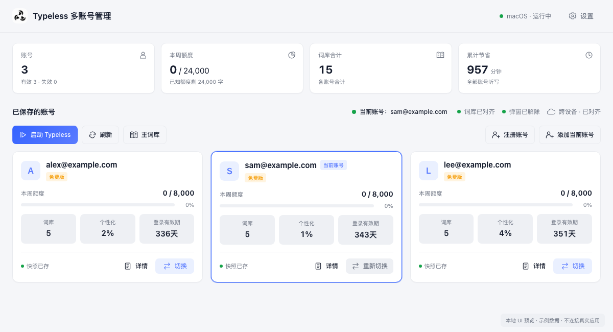

<div align="center">


# Typeless Toolkit

A local helper for the Typeless desktop app: manage accounts, dictionary, backups and sync in one window.

[](https://github.com/Jia131313/typeless-toolkit/releases/latest)
[](https://github.com/Jia131313/typeless-toolkit/actions/workflows/check.yml)
[](LICENSE)


[Download](https://github.com/Jia131313/typeless-toolkit/releases/latest) · [Quick start](#quick-start) · [Documentation](docs/reference.md) · [Issues](https://github.com/Jia131313/typeless-toolkit/issues)

**English** · [简体中文](README.md) · [繁體中文](README.zh-TW.md) · [日本語](README.ja.md) · [한국어](README.ko.md)

</div>

> This is a community project, not affiliated with [Typeless](https://typeless.com/). Please read the [important notes](#important-notes) and the [disclaimer](#disclaimer) below before use. This README describes the current `main` branch; features in a published installer follow that Release's own notes.

## Overview

Typeless Toolkit is a desktop manager that runs on your own computer, for people who switch between multiple Typeless accounts, maintain a personal dictionary, or migrate account data between machines. It reuses one local Node.js backend and one management page: Windows uses a standalone WebView2 window with a tray icon, macOS uses Tauri 2 and the system WKWebView. Linux is not supported yet.

| Area | What you can do |
| --- | --- |
| Account management | Capture the signed-in account, check its status, save a local login snapshot and switch between accounts. Quota monitoring can warn you or switch automatically. |
| Dictionary | Merge each account's personal terms into a master dictionary, edit it, and align accounts on demand. Speech-style models are not part of what can be migrated. |
| Backup and sync | Sync account credentials and the master dictionary over encrypted WebDAV; also import and export account files and dictionaries manually. |
| Desktop maintenance | Check for toolkit updates and handle compatibility maintenance; on macOS, install an official Typeless update that has already been downloaded and verified locally. |

The toolkit also offers device-identity reset, onboarding skip, and an experimental popup-maintenance feature that modifies Typeless application files. These differ from everyday account and dictionary work — read [behavior and risks](#important-notes) and the [platform details](docs/platform.md#macos-适配) first.



_A sample of the current management page; account, quota and dictionary figures are fictional and are not connected to a real app._

## Download and install

Pick the asset in [Releases](https://github.com/Jia131313/typeless-toolkit/releases/latest) that matches your OS and CPU architecture:

| System | Recommended (filename suffix) | Who the Lite build is for | How to start |
| --- | --- | --- | --- |
| Windows 10/11 x64 | `win-x64-portable-setup.exe`, bundled Node.js | You already have Node.js 22.12+ (Node 24 LTS recommended) | Run the installer; a no-install ZIP is also available |
| macOS Apple Silicon | `mac-arm64-portable.dmg`, bundled Node.js for the same architecture | You already have Node.js 22.12+ for the same architecture | Open the DMG and drag the app into Applications |
| macOS Intel | `mac-x64-portable.dmg`, bundled Node.js for the same architecture | You already have Node.js 22.12+ for the same architecture | Open the DMG and drag the app into Applications |

Asset names change between versions; match on the suffix shown above. A feature just merged into `main` may not be in the latest installer yet — the Release notes for that version are authoritative.

Typeless desktop must be installed first. On Windows you also need the Microsoft Edge WebView2 Runtime, which most Windows 10/11 machines already have. macOS builds currently use ad-hoc signing; if the system blocks the first launch, right-click the app in Finder and choose Open. Every asset ships with a matching SHA-256 checksum file.

Public packages start from an empty account list and an empty snapshot directory — no maintainer data is included. On the Windows installer edition, data lives in `%LOCALAPPDATA%\TypelessToolkit\data`, separate from the program directory, and survives upgrades and uninstalls. If you use the ZIP, keep the `data/` directory from your previous extraction when upgrading; do not overwrite it with the empty one from the new package.

Prefer Portable. Lite carries no Node.js and is smaller, but you maintain the runtime yourself. On macOS, user data lives in `~/Library/Application Support/Typeless 工具集/data/`, and replacing the app does not move or delete that directory.

Windows ships both a bundled-Node Setup and a Lite Setup, and keeps both ZIP variants. For daily use the bundled-Node installer is recommended, since its runtime updates with the toolkit. Separate data directories, migrating from an older ZIP, and maintaining a Lite runtime are covered in [the Windows installer guide](docs/windows-installer.md). Always go by the actual Release assets. Lite requires Node 22.12+ (Node 24 LTS recommended); a Node installed from the official site will not update itself, and automatic account switching additionally needs working SQLite and read access to the Typeless database.

## Quick start

1. Start Typeless, sign in to an account, then open the toolkit.
2. On the home screen click **Add current account**. The toolkit briefly captures the credentials and saves a local login snapshot; after that you can switch from the account card.
3. For more accounts, repeat the step above. To keep devices in sync continuously, configure WebDAV under **Settings → Sync and data**. For a one-off migration, use **Backup and migration** to export the selected accounts and the master dictionary into a single file.

If Typeless is not in its default install location, set `typeless_exe` in `config.json` (source) or `data/config.json` (Windows package). More operations, data directories and common questions are covered in the [documentation](docs/reference.md).

## Important notes

- **Account credentials:** exported account JSON and the local `accounts.json` contain long-lived login credentials. Treat them like a password and never attach them to a public issue. WebDAV sync encrypts the selected credentials and dictionary, but a lost sync password means the remote data cannot be decrypted.
- **Backup scope:** a migration backup can contain the selected accounts and the master dictionary, or just one of the two. It does not include device information, the WebDAV password, local login snapshots, or sync deletion records. After importing on another machine you still need to click **Enable on this device** for each account. Existing account files and dictionary TXT/CSV files can still be imported. See [Backup and migration](docs/account-backup.md) and the [file format](docs/account-bundle-format.md).
- **Two kinds of update:** **Toolkit update** downloads a Release of this project. On macOS, **Install official Typeless update** only handles a cached package the Typeless updater has already downloaded to this machine; it does not look for the latest official version online. They are not the same operation.
- **Application modification:** popup maintenance modifies Typeless install files. It can break when the official version changes, and may affect Typeless's own updater or macOS permissions. It and device reset should only be used once you understand the impact; recovery and troubleshooting are covered in the [documentation](docs/reference.md).

## Disclaimer

This is a community project. It is not affiliated with, endorsed by, or sponsored by Typeless, and Typeless software and trademarks belong to their respective owners.

- **Intended use.** The toolkit is provided for personal learning, research, and interoperability with software you already have the right to use. It is not intended to circumvent payment for services you would otherwise be required to pay for, and must not be used commercially, resold, or redistributed as a product.
- **Third-party terms.** Some features modify Typeless application files or reset device identity. Those operations may conflict with Typeless's terms of service, and may stop working after an official update. Check the relevant terms and the law where you live before using them.
- **No warranty.** The software is provided "as is", without warranty of any kind. The authors accept no liability for any consequence of using it, including but not limited to account suspension, data loss, or damage to an application.
- **Your responsibility.** You are solely responsible for how you use this toolkit and for the outcome. If the law where you live, or the Typeless terms of service, prohibits these operations, do not use it. Continuing to use it means you have read and accepted this notice.

The full [usage statement and license](docs/reference.md#使用声明与许可证) is in the documentation.

## Running from source

Node.js 22.12+ is required; development and build details follow the repository files.

```bash
npm ci
npm run check
node manager.js
```

The management page is served at `http://127.0.0.1:7788` by default. On macOS, `npm run build:mac` builds a Portable DMG for the current architecture; Windows packaging entry points and caveats are in the [installation guide](docs/installation.md#windows-桌面窗口与托盘). Main code layout: `manager.js` provides the local API, `manager.html` is the management page, `lib/` holds shared business logic, and `windows/` and `src-tauri/` are the Windows and macOS desktop hosts.

## Documentation and feedback

- [Documentation index: installation, accounts and backup, sync, troubleshooting, platform notes](docs/reference.md)
- [Typeless Account Bundle v1: account file format](docs/account-bundle-format.md)
- [Open an issue](https://github.com/Jia131313/typeless-toolkit/issues): include your OS, Typeless and toolkit versions, reproduction steps and error text. Never attach account credentials, private dictionary data, or a WebDAV password.

Released under the [MIT license](LICENSE). Thanks to the [LINUX DO community](https://linux.do/) for feedback and support; the device-reset approach was informed by [typeless-reset-device](https://github.com/estarpro1022/typeless-reset-device).

## Interface languages

Nine interface languages are built in: Simplified Chinese, Traditional Chinese, English, Japanese, Korean, Spanish, French, German and Turkish. Choose one under **Settings → General → Interface language**. Translations ship with the app — no network translation is used — and the preference persists across restarts. See [LOCALIZATION.md](docs/LOCALIZATION.md) for usage, maintenance and validation.
