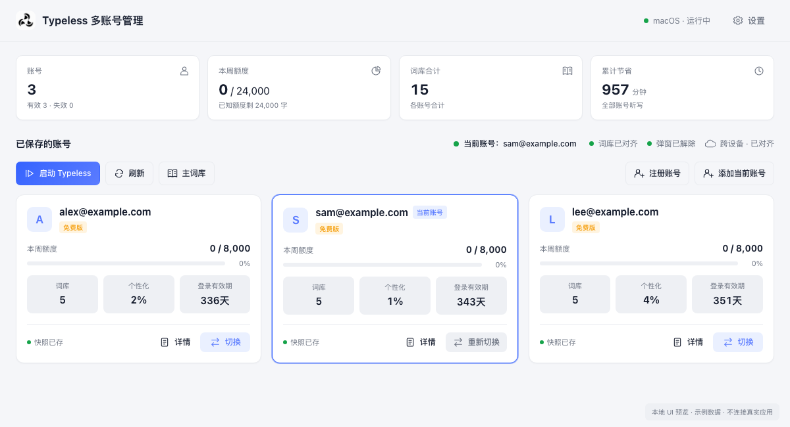

<div align="center">


# Typeless ツールキット

Typeless デスクトップアプリ向けのローカル補助ツールです。1 つのウィンドウでアカウント、辞書、バックアップ、同期を管理できます。

[](https://github.com/Jia131313/typeless-toolkit/releases/latest)
[](https://github.com/Jia131313/typeless-toolkit/actions/workflows/check.yml)
[](LICENSE)


[最新版をダウンロード](https://github.com/Jia131313/typeless-toolkit/releases/latest) · [クイックスタート](#クイックスタート) · [ドキュメント](docs/reference.md) · [問題を報告](https://github.com/Jia131313/typeless-toolkit/issues)

[English](README.en.md) · [简体中文](README.md) · [繁體中文](README.zh-TW.md) · **日本語** · [한국어](README.ko.md)

</div>

> これはコミュニティプロジェクトであり、[Typeless](https://typeless.com/) 公式とは無関係です。使用前に下記の[重要事項](#重要事項)と[免責事項](#免責事項)をお読みください。この README は現在の `main` ブランチを説明したものです。公開済みインストーラーの機能は、対応する Release の説明が優先されます。

## プロジェクト紹介

Typeless ツールキットは、自分のパソコン上で動作するデスクトップマネージャーです。複数の Typeless アカウントを切り替えたい方、個人辞書を管理したい方、アカウント情報を移行したい方に適しています。ローカルの Node.js バックエンドと管理ページを 1 つずつ共用し、Windows では WebView2 の独立ウィンドウとタスクトレイを、macOS では Tauri 2 とシステムの WKWebView を使用します。Linux は未対応です。

| 機能 | できること |
| --- | --- |
| 複数アカウント管理 | 現在サインイン中のアカウントを取り込み、状態を確認し、本機のログインスナップショットを保存してアカウントを切り替えます。残量監視では通知または自動切り替えを選べます。 |
| 辞書管理 | 各アカウントの個人辞書エントリをマスター辞書に集約し、編集後に必要に応じて各アカウントへ反映します。話し方スタイルのモデルは移行対象外です。 |
| バックアップと同期 | WebDAV でアカウントの認証情報とマスター辞書を暗号化同期します。アカウントファイルと辞書の手動インポート・エクスポートも可能です。 |
| デスクトップのメンテナンス | ツールキットの更新確認と互換性メンテナンスを行います。macOS では、Typeless がダウンロード済みで検証済みの公式更新キャッシュをインストールできます。 |

ツールキットには、デバイス識別子のリセット、オンボーディングのスキップ、Typeless アプリのファイルを変更する実験的なポップアップメンテナンス機能もあります。これらは日常的なアカウント・辞書管理とは異なるため、使用前に[動作とリスク](#重要事項)および[プラットフォームの詳細](docs/platform.md#macos-适配)をご確認ください。



_現在の管理ページのサンプル画像です。アカウント、残量、辞書の数値はすべて架空のデータで、実際のアプリには接続していません。_

## ダウンロードとインストール

[Releases](https://github.com/Jia131313/typeless-toolkit/releases/latest) で、お使いの OS と CPU アーキテクチャに合った添付ファイルを選んでください。

| システム | 推奨ダウンロード（ファイル名の接尾辞） | Lite 版が向いている人 | 起動方法 |
| --- | --- | --- | --- |
| Windows 10/11 x64 | `win-x64-portable-setup.exe`、Node.js 同梱 | Node.js 22.12+ を導入済み（Node 24 LTS を推奨） | インストーラーを実行します。インストール不要の ZIP も選べます |
| macOS Apple Silicon | `mac-arm64-portable.dmg`、同アーキテクチャの Node.js を同梱 | 同アーキテクチャの Node.js 22.12+ を導入済み | DMG を開き、アプリを「アプリケーション」へドラッグします |
| macOS Intel | `mac-x64-portable.dmg`、同アーキテクチャの Node.js を同梱 | 同アーキテクチャの Node.js 22.12+ を導入済み | DMG を開き、アプリを「アプリケーション」へドラッグします |

添付ファイル名はバージョンごとに変わります。表に示した接尾辞で選んでください。`main` にマージされたばかりの機能は最新のインストーラーにまだ含まれていない場合があります。その Release の更新内容を優先してください。

実行前に Typeless デスクトップアプリをインストールしておく必要があります。Windows では Microsoft Edge WebView2 Runtime も必要です（ほとんどの Windows 10/11 端末には既に入っています）。macOS の配布パッケージは現在 ad-hoc 署名を使用しています。初回起動時にシステムにブロックされた場合は、Finder でアプリを右クリックして「開く」を選んでください。各添付ファイルには個別の SHA-256 検証ファイルが付属します。

公開パッケージは空のアカウントリストと空のスナップショットディレクトリから始まり、メンテナーの個人データは含まれません。Windows インストール版のデータは `%LOCALAPPDATA%\TypelessToolkit\data` に保存され、プログラムディレクトリとは分離されているため、アップグレードやアンインストールでもデータは残ります。ZIP 版のユーザーがアップグレードする際は、以前の展開先の `data/` を必ず残し、新しいパッケージの空のデータディレクトリで上書きしないでください。

Portable を推奨します。Lite は Node.js を含まないためサイズは小さいですが、実行環境は自分で管理する必要があります。macOS のユーザーデータは `~/Library/Application Support/Typeless 工具集/data/` に保存され、App を入れ替えてもこのディレクトリは自動的に移動も削除もされません。

Windows では Node 同梱版と Lite 版の 2 種類の Setup を提供し、2 種類の ZIP も維持しています。日常利用には実行環境がツールキットと一緒に更新される Node 同梱インストール版を推奨します。独立したデータディレクトリ、旧 ZIP からの移行、Lite 環境の管理方法は[Windows インストール版の説明](docs/windows-installer.md)をご覧ください。ダウンロードは Release の実際の添付ファイルが基準です。Lite の基本要件は Node 22.12+（Node 24 LTS を推奨）です。公式サイトからインストールした Node は自動更新されません。また自動アカウント切り替えには、実際の SQLite と Typeless データベースの読み取り能力が必要です。

## クイックスタート

1. Typeless を起動して 1 つのアカウントにサインインし、次にツールキットを開きます。
2. ホーム画面で「現在のアカウントを追加」をクリックします。ツールキットは一時的に認証情報を取得して本機のログインスナップショットを保存します。完了後はアカウントカードから切り替えられます。
3. アカウントが複数ある場合は前の手順を繰り返します。継続的にデバイス間で同期する場合は「設定 → 同期とデータ」で WebDAV を構成します。一度だけ移行する場合は「バックアップと移行」を使い、選択したアカウントとマスター辞書を 1 つのファイルにエクスポートします。

Typeless が既定のインストール先にない場合は、`config.json`（ソース）または `data/config.json`（Windows 配布パッケージ）で `typeless_exe` を設定できます。その他の操作、データディレクトリ、よくある質問は[ドキュメント](docs/reference.md)をご覧ください。

## 重要事項

- **アカウントの認証情報：** エクスポートしたアカウント JSON と本機の `accounts.json` には長期有効なログイン認証情報が含まれます。パスワードと同様に保管し、公開 Issue にアップロードしないでください。WebDAV 同期は選択したアカウントの認証情報と辞書を暗号化しますが、同期パスワードを紛失するとリモートのデータは復号できません。
- **バックアップの範囲：** 移行バックアップには選択したアカウントとマスター辞書を含められますが、どちらか一方だけをエクスポートすることもできます。デバイス情報、WebDAV パスワード、本機のログインスナップショット、同期の削除記録は含まれません。別のマシンへインポートした後も、対象デバイスで「このデバイスで有効にする」を 1 つずつクリックする必要があります。従来のアカウントファイルと辞書の TXT/CSV も引き続きインポートできます。[バックアップと移行](docs/account-backup.md)および[ファイル形式](docs/account-bundle-format.md)をご覧ください。
- **2 種類の更新：** 「ツールキットの更新」は本プロジェクトの Release をダウンロードします。macOS の「Typeless 公式更新をインストール」は、Typeless updater が本機にダウンロード済みのキャッシュパッケージのみを処理し、オンラインで公式の最新版を探しに行くことはありません。この 2 つは同じ操作ではありません。
- **アプリの変更：** ポップアップメンテナンスは Typeless のインストールファイルを変更します。公式バージョンの変化により動作しなくなる可能性があり、Typeless 本来の更新や macOS の権限に影響する場合があります。これとデバイスリセットは、影響を理解したうえで使用してください。失敗時の復旧とトラブルシューティングは[ドキュメント](docs/reference.md)をご覧ください。

## 免責事項

本プロジェクトはコミュニティプロジェクトであり、Typeless 公式とは一切の提携、スポンサー、承認関係にありません。Typeless ソフトウェアおよび関連する商標、著作権のすべての権利は、それぞれの権利者に帰属します。

- **用途の限定。** 本ツールキットは、個人の学習、研究、およびあなたがすでに使用する権利を持つソフトウェアとの相互運用のために提供されます。本来支払うべきサービスの対価を回避することを目的とするものではなく、商業利用、製品としての転売や再配布はできません。
- **第三者による規約。** 一部の機能は Typeless アプリのファイルを変更したり、デバイス識別子をリセットしたりします。これらの操作は Typeless の利用規約と衝突する可能性があり、公式更新後に動作しなくなることがあります。使用前に該当する規約とお住まいの地域の法律をご自身で確認してください。
- **無保証。** 本ソフトウェアは「現状のまま」提供され、いかなる種類の保証も伴いません。作者は本ツールキットの使用によって生じたいかなる結果についても責任を負いません。これにはアカウントの停止、データの損失、アプリの破損などが含まれますが、これらに限りません。
- **自己責任。** 本ツールキットの使用方法とその結果は、あなた自身が負担します。お住まいの地域の法律または Typeless の利用規約がこのような操作を禁じている場合は使用しないでください。使用を続けた場合、あなたが本声明を読み、承諾したものとみなします。

完全な[使用声明とライセンス](docs/reference.md#使用声明与许可证)は詳細ドキュメントをご覧ください。

## ソースから実行

Node.js 22.12+ が必要です。開発とビルドの手順はリポジトリ内のファイルに従ってください。

```bash
npm ci
npm run check
node manager.js
```

管理ページは既定で `http://127.0.0.1:7788` にあります。macOS では `npm run build:mac` で現在のアーキテクチャ向けの Portable DMG をビルドできます。Windows のパッケージング手順と注意点は[インストールガイド](docs/installation.md#windows-桌面窗口与托盘)をご覧ください。主なコードの分担は次のとおりです。`manager.js` がローカル API を提供し、`manager.html` が管理ページ、`lib/` に共通の業務ロジック、`windows/` と `src-tauri/` がそれぞれ Windows と macOS のデスクトップホストです。

## ドキュメントとフィードバック

- [ドキュメント案内：インストール、アカウントとバックアップ、同期、トラブルシューティング、プラットフォーム実装](docs/reference.md)
- [Typeless Account Bundle v1：アカウントファイル形式](docs/account-bundle-format.md)
- [Issue の投稿](https://github.com/Jia131313/typeless-toolkit/issues)：OS、Typeless とツールキットのバージョン、再現手順、エラーメッセージを添えてください。アカウントの認証情報、辞書の個人データ、WebDAV パスワードは添付しないでください。

本プロジェクトは [MIT ライセンス](LICENSE)を採用しています。[LINUX DO フォーラムコミュニティ](https://linux.do/)のご注目、フィードバック、ご支援に感謝します。デバイスリセットのアイデアは [typeless-reset-device](https://github.com/estarpro1022/typeless-reset-device) を参考にしました。

## 表示言語

9 種類の表示言語を同梱しています：简体中文、繁體中文、English、日本語、한국어、Español、Français、Deutsch、Türkçe。「設定 → 一般 → 表示言語」で切り替えられます。翻訳はパッケージに同梱されるためネットワーク接続は不要で、言語の設定は再起動後も保持されます。使い方、メンテナンス、検証方法は [LOCALIZATION.md](docs/LOCALIZATION.md) をご覧ください。
