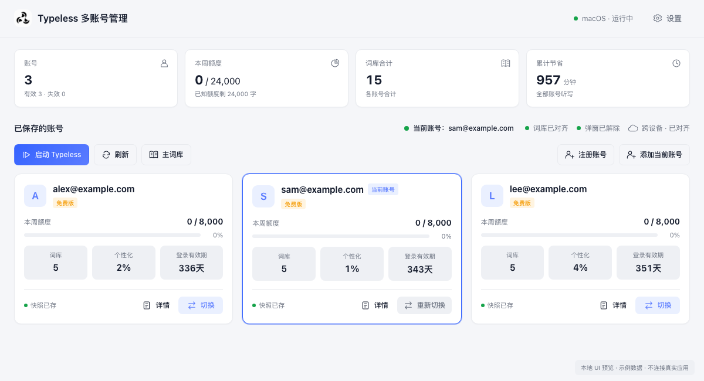

<div align="center">


# Typeless 툴킷

Typeless 데스크톱 앱을 위한 로컬 보조 도구로, 하나의 창에서 계정, 사전, 백업과 동기화를 관리합니다.

[](https://github.com/Jia131313/typeless-toolkit/releases/latest)
[](https://github.com/Jia131313/typeless-toolkit/actions/workflows/check.yml)
[](LICENSE)


[최신 버전 다운로드](https://github.com/Jia131313/typeless-toolkit/releases/latest) · [빠른 시작](#빠른-시작) · [전체 문서](docs/reference.md) · [문제 제보](https://github.com/Jia131313/typeless-toolkit/issues)

[English](README.en.md) · [简体中文](README.md) · [繁體中文](README.zh-TW.md) · [日本語](README.ja.md) · **한국어**

</div>

> 커뮤니티 프로젝트이며 [Typeless](https://typeless.com/) 공식과 무관합니다. 사용 전 아래 [중요 안내](#중요-안내)와 [면책 조항](#면책-조항)을 읽어 주세요. 이 README는 현재 `main` 브랜치를 설명합니다. 이미 배포된 설치 패키지의 기능은 해당 Release 설명을 기준으로 합니다.

## 프로젝트 소개

Typeless 툴킷은 자신의 컴퓨터에서 실행되는 데스크톱 관리자로, 여러 Typeless 계정을 전환하거나 개인 사전을 유지 관리하거나 계정 데이터를 마이그레이션해야 하는 사용자에게 적합합니다. 하나의 로컬 Node.js 백엔드와 하나의 관리 페이지를 재사용합니다. Windows는 WebView2 독립 창과 트레이를 사용하고, macOS는 Tauri 2와 시스템 WKWebView를 사용합니다. Linux는 아직 지원하지 않습니다.

| 기능 | 할 수 있는 일 |
| --- | --- |
| 다중 계정 관리 | 현재 로그인한 계정을 등록하고 상태를 확인하며, 이 기기의 로그인 스냅샷을 저장하고 계정을 전환합니다. 할당량 모니터링은 선택적으로 알림을 보내거나 자동으로 전환할 수 있습니다. |
| 사전 관리 | 각 계정의 개인 단어를 마스터 사전으로 모아 편집한 뒤 필요할 때 계정에 맞춰 정렬합니다. 말하기 스타일 모델은 마이그레이션 범위에 포함되지 않습니다. |
| 백업과 동기화 | WebDAV로 계정 자격 증명과 마스터 사전을 암호화해 동기화합니다. 계정 파일과 사전을 직접 가져오거나 내보낼 수도 있습니다. |
| 데스크톱 유지 관리 | 툴킷 업데이트를 확인하고 호환성 유지 관리를 처리합니다. macOS에서는 Typeless가 이미 다운로드하고 검증한 공식 업데이트 캐시를 설치할 수 있습니다. |

툴킷에는 기기 식별자 재설정, 신규 사용자 안내 건너뛰기, Typeless 앱 파일을 수정하는 실험적 팝업 유지 관리 기능도 있습니다. 이런 작업은 일상적인 계정·사전 관리와 성격이 다르므로 사용 전 [동작과 위험](#중요-안내) 및 [플랫폼 세부 사항](docs/platform.md#macos-适配)을 확인하세요.



_현재 관리 페이지의 예시 스크린샷입니다. 계정, 할당량, 사전 수치는 모두 가상 데이터이며 실제 앱과 연결되지 않습니다._

## 다운로드 및 설치

[Releases](https://github.com/Jia131313/typeless-toolkit/releases/latest)에서 운영 체제와 CPU 아키텍처에 맞는 첨부 파일을 선택하세요.

| 시스템 | 권장 다운로드(파일 이름 접미사) | Lite 버전이 적합한 사용자 | 실행 방법 |
| --- | --- | --- | --- |
| Windows 10/11 x64 | `win-x64-portable-setup.exe`, Node.js 내장 | Node.js 22.12+가 이미 설치된 경우, Node 24 LTS 권장 | 설치 마법사를 실행합니다. 설치 없이 쓰려면 ZIP을 선택할 수 있습니다 |
| macOS Apple Silicon | `mac-arm64-portable.dmg`, 같은 아키텍처 Node.js 내장 | 같은 아키텍처의 Node.js 22.12+가 이미 설치된 경우 | DMG를 열고 앱을 "응용 프로그램" 폴더로 드래그합니다 |
| macOS Intel | `mac-x64-portable.dmg`, 같은 아키텍처 Node.js 내장 | 같은 아키텍처의 Node.js 22.12+가 이미 설치된 경우 | DMG를 열고 앱을 "응용 프로그램" 폴더로 드래그합니다 |

첨부 파일 이름은 버전에 따라 달라지므로 표에 나온 접미사를 기준으로 선택하면 됩니다. 방금 `main`에 병합된 기능은 최신 설치 패키지에 아직 들어가지 않았을 수 있으니 해당 Release의 변경 설명을 기준으로 하세요.

실행하려면 먼저 Typeless 데스크톱 앱을 설치해야 합니다. Windows에서는 Microsoft Edge WebView2 Runtime도 필요합니다(대부분의 Windows 10/11 기기에 이미 설치되어 있습니다). macOS 배포 패키지는 현재 ad-hoc 서명을 사용합니다. 처음 열 때 시스템이 차단하면 Finder에서 앱을 마우스 오른쪽 버튼으로 클릭해 "열기"를 선택하세요. 각 설치 첨부 파일에는 별도의 SHA-256 검증 파일이 함께 제공됩니다.

공개 패키지는 빈 계정 목록과 빈 스냅샷 디렉터리에서 시작하며, 유지 관리자의 개인 데이터를 포함하지 않습니다. Windows 설치 버전의 데이터는 `%LOCALAPPDATA%\TypelessToolkit\data`에 저장되어 프로그램 디렉터리와 분리되고, 업그레이드와 제거 시에도 유지됩니다. ZIP 사용자는 업그레이드할 때 기존 압축 해제 디렉터리의 `data/`를 반드시 보관하고, 새 패키지에 들어 있는 빈 데이터 디렉터리로 덮어쓰지 마세요.

Portable을 우선 선택하세요. Lite는 Node.js를 포함하지 않아 용량이 더 작지만 실행 환경을 직접 관리해야 합니다. macOS 사용자 데이터는 `~/Library/Application Support/Typeless 工具集/data/`에 저장되며, App을 교체해도 이 디렉터리가 자동으로 옮겨지거나 삭제되지 않습니다.

Windows는 Node 내장 Setup과 Lite Setup 두 가지를 제공하고 ZIP 두 종류도 유지합니다. 일상적으로는 Node 내장 설치 버전을 권장하며, 실행 환경이 툴킷과 함께 업데이트됩니다. 별도 데이터 디렉터리, 이전 ZIP에서 마이그레이션, Lite 환경 유지 관리 방법은 [Windows 설치 버전 안내](docs/windows-installer.md)를 참고하세요. 다운로드는 Release의 실제 첨부 파일을 기준으로 합니다. Lite의 기본 요구 사항은 Node 22.12+이며 Node 24 LTS를 권장합니다. 공식 사이트에서 설치한 Node는 스스로 업데이트되지 않으며, 자동 계정 전환에는 실제 SQLite와 Typeless 데이터베이스 읽기 기능도 필요합니다.

## 빠른 시작

1. Typeless를 실행하고 계정 하나로 로그인한 다음 툴킷을 엽니다.
2. 홈 화면에서 "현재 계정 추가"를 클릭합니다. 툴킷이 자격 증명을 잠시 가져와 이 기기의 로그인 스냅샷을 저장하고, 완료되면 계정 카드에서 전환할 수 있습니다.
3. 계정이 여러 개라면 앞 단계를 반복합니다. 기기 간 동기화를 계속 유지하려면 "설정 → 동기화 및 데이터"에서 WebDAV를 구성하세요. 한 번만 마이그레이션한다면 "백업 및 마이그레이션"으로 선택한 계정과 마스터 사전을 하나의 파일로 내보내면 됩니다.

Typeless가 기본 설치 위치에 없으면 `config.json`(소스) 또는 `data/config.json`(Windows 배포 패키지)에서 `typeless_exe`를 설정할 수 있습니다. 더 많은 작업, 데이터 디렉터리, 자주 묻는 질문은 [전체 문서](docs/reference.md)를 참고하세요.

## 중요 안내

- **계정 자격 증명:** 내보낸 계정 JSON과 이 기기의 `accounts.json`에는 장기 로그인 자격 증명이 들어 있습니다. 비밀번호처럼 관리하고 공개 Issue에 올리지 마세요. WebDAV 동기화는 선택한 계정 자격 증명과 사전을 암호화하지만, 동기화 비밀번호를 잃으면 원격 데이터를 복호화할 수 없습니다.
- **백업 범위:** 마이그레이션 백업에는 선택한 계정과 마스터 사전이 모두 들어갈 수도 있고 둘 중 하나만 들어갈 수도 있습니다. 기기 정보, WebDAV 비밀번호, 이 기기의 로그인 스냅샷, 동기화 삭제 기록은 포함되지 않습니다. 다른 기기에서 가져온 뒤에도 대상 기기에서 계정마다 "이 기기에서 사용"을 클릭해야 합니다. 기존 계정 파일과 사전 TXT/CSV는 계속 가져올 수 있습니다. [백업과 마이그레이션](docs/account-backup.md) 및 [파일 형식](docs/account-bundle-format.md)을 참고하세요.
- **두 가지 업데이트:** "툴킷 업데이트"는 이 프로젝트의 Release를 내려받습니다. macOS의 "Typeless 공식 업데이트 설치"는 Typeless updater가 이미 이 기기에 내려받은 캐시 패키지만 처리하며, 공식 최신 버전을 온라인에서 찾지 않습니다. 두 가지는 서로 다른 작업입니다.
- **앱 수정:** 팝업 유지 관리는 Typeless 설치 파일을 수정하므로 공식 버전이 바뀌면 작동하지 않을 수 있고, Typeless 자체 업데이트나 macOS 권한에 영향을 줄 수도 있습니다. 기기 재설정과 마찬가지로 영향을 이해한 뒤 사용해야 하며, 실패 시 복구와 문제 해결 방법은 [전체 문서](docs/reference.md)를 참고하세요.

## 면책 조항

이 프로젝트는 커뮤니티 프로젝트로, Typeless 공식과 어떠한 제휴, 후원, 승인 관계도 없습니다. Typeless 소프트웨어와 관련 상표, 저작권의 모든 권리는 원래 권리자에게 있습니다.

- **용도 제한.** 이 툴킷은 개인 학습, 연구, 그리고 이미 사용 권한이 있는 소프트웨어와의 상호 운용을 위해 제공됩니다. 유료로 이용해야 할 서비스를 우회하는 것을 목적으로 하지 않으며, 상업적 목적으로 사용하거나 제품으로 재판매 또는 재배포할 수 없습니다.
- **제3자 약관.** 일부 기능은 Typeless 앱 파일을 수정하거나 기기 식별자를 재설정합니다. 이런 작업은 Typeless 서비스 약관과 충돌할 수 있고, 공식 업데이트 후 작동하지 않을 수도 있습니다. 사용 전 관련 약관과 거주 지역의 법률을 직접 확인하세요.
- **보증 없음.** 이 소프트웨어는 "있는 그대로" 제공되며 어떠한 형태의 보증도 따르지 않습니다. 작성자는 이 툴킷 사용으로 생기는 모든 결과에 대해 책임지지 않으며, 여기에는 계정 정지, 데이터 손실, 앱 손상 등이 포함되나 이에 한정되지 않습니다.
- **책임은 사용자에게 있습니다.** 툴킷을 사용하는 방식과 그 결과는 모두 사용자가 감당해야 합니다. 거주 지역의 법률이나 Typeless 서비스 약관이 이런 작업을 금지한다면 사용하지 마세요. 계속 사용하는 것은 본 선언을 읽고 수락한 것으로 간주됩니다.

전체 [사용 선언 및 라이선스](docs/reference.md#使用声明与许可证)는 상세 문서를 참고하세요.

## 소스에서 실행

Node.js 22.12+가 필요하며, 개발과 빌드 설명은 저장소 파일을 기준으로 합니다.

```bash
npm ci
npm run check
node manager.js
```

관리 페이지는 기본적으로 `http://127.0.0.1:7788`에서 제공됩니다. macOS에서는 `npm run build:mac`으로 현재 아키텍처용 Portable DMG를 빌드할 수 있습니다. Windows 패키징 진입점과 주의 사항은 [설치 안내](docs/installation.md#windows-桌面窗口与托盘)를 참고하세요. 주요 코드 구성은 다음과 같습니다. `manager.js`가 로컬 API를 제공하고, `manager.html`은 관리 페이지이며, `lib/`에는 공용 비즈니스 로직이 있고, `windows/`와 `src-tauri/`는 각각 Windows, macOS 데스크톱 호스트입니다.

## 문서와 피드백

- [문서 안내: 설치, 계정과 백업, 동기화, 문제 해결, 플랫폼 구현](docs/reference.md)
- [Typeless Account Bundle v1: 계정 파일 형식](docs/account-bundle-format.md)
- [Issue 제출](https://github.com/Jia131313/typeless-toolkit/issues): 운영 체제, Typeless와 툴킷 버전, 재현 단계, 오류 메시지를 함께 적어 주세요. 계정 자격 증명, 사전의 개인 데이터, WebDAV 비밀번호는 첨부하지 마세요.

이 프로젝트는 [MIT 라이선스](LICENSE)를 따릅니다. [LINUX DO 포럼 커뮤니티](https://linux.do/)의 관심과 피드백, 지원에 감사드립니다. 기기 재설정 아이디어는 [typeless-reset-device](https://github.com/estarpro1022/typeless-reset-device)를 참고했습니다.

## 인터페이스 언어

내장된 인터페이스 언어는 아홉 가지입니다: 중국어 간체, 중국어 번체, English, 日本語, 한국어, Español, Français, Deutsch, Türkçe. "설정 → 일반 → 인터페이스 언어"에서 전환할 수 있습니다. 번역은 패키지에 내장되어 있어 인터넷 연결이 필요 없고, 언어 설정은 다시 시작해도 유지됩니다. 사용법, 유지 관리, 검증 방법은 [LOCALIZATION.md](docs/LOCALIZATION.md)를 참고하세요.
