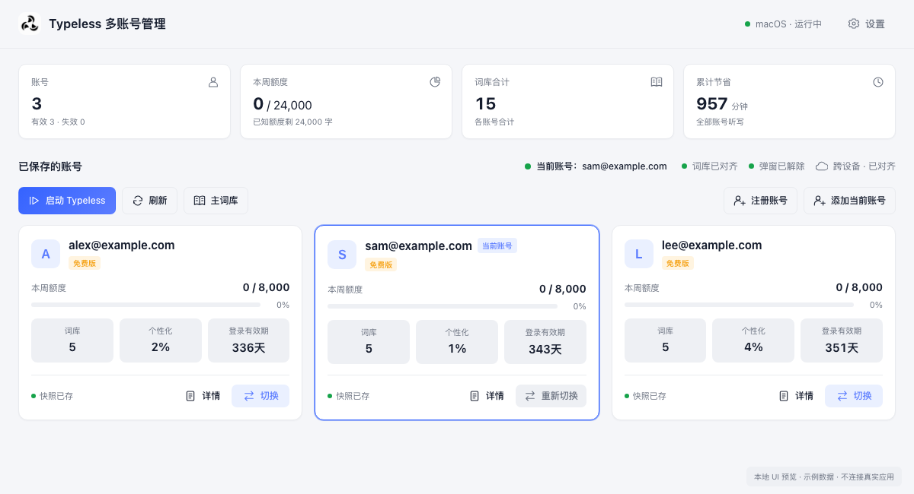

<div align="center">


# Typeless 工具集

面向 Typeless 桌面端的本地辅助工具：在一个窗口中管理账号、词库、备份与同步。

[](https://github.com/Jia131313/typeless-toolkit/releases/latest)
[](https://github.com/Jia131313/typeless-toolkit/actions/workflows/check.yml)
[](LICENSE)


[下载最新版本](https://github.com/Jia131313/typeless-toolkit/releases/latest) · [快速开始](#快速开始) · [完整文档](docs/reference.md) · [反馈问题](https://github.com/Jia131313/typeless-toolkit/issues)

[English](README.en.md) · **简体中文** · [繁體中文](README.zh-TW.md) · [日本語](README.ja.md) · [한국어](README.ko.md)

</div>

> 这是社区项目，与 [Typeless](https://typeless.com/) 官方无关联。使用前请阅读下方的[重要说明](#重要说明)与[免责声明](#免责声明)。README 描述当前 `main` 分支；已发布安装包的功能以对应 Release 说明为准。

## 项目介绍

Typeless 工具集是运行在自己电脑上的桌面管理器，适合需要在多个 Typeless 账号之间切换、维护个人词库，或迁移账号资料的用户。它复用一个本地 Node.js 后端和管理页面：Windows 使用 WebView2 独立窗口与托盘，macOS 使用 Tauri 2 与系统 WKWebView。Linux 暂未适配。

| 能力 | 可以做什么 |
| --- | --- |
| 多账号管理 | 收录当前登录账号、查看状态、保存本机登录快照并切换账号；额度监控可选提醒或自动切换。 |
| 词库管理 | 汇总各账号的个人词条到主词库，编辑后按需对齐；说话风格模型不在可迁移范围内。 |
| 备份与同步 | 用 WebDAV 加密同步账号凭证和主词库；也可手动导入、导出账号文件与词库。 |
| 桌面维护 | 查看工具集更新、处理兼容性维护；macOS 可安装 Typeless 已下载并经校验的官方更新缓存。 |

工具集还有设备标识重置、跳过新手引导和修改 Typeless 应用文件的实验性弹窗维护能力。这些操作与日常账号、词库管理不同，使用前请了解[行为与风险](#重要说明)及[平台细节](docs/platform.md#macos-适配)。



_当前管理页面的示例截图；账号、额度和词库数字均为虚构数据，不连接真实应用。_

## 下载与安装

在 [Releases](https://github.com/Jia131313/typeless-toolkit/releases/latest) 选择与系统和 CPU 架构匹配的附件：

| 系统 | 推荐下载（文件名后缀） | Lite 版本适合谁 | 启动方式 |
| --- | --- | --- | --- |
| Windows 10/11 x64 | `win-x64-portable-setup.exe`，内置 Node.js | 已安装 Node.js 22.12+，推荐 Node 24 LTS | 运行安装向导；免安装可选 ZIP |
| macOS Apple Silicon | `mac-arm64-portable.dmg`，内置同架构 Node.js | 已安装同架构 Node.js 22.12+ | 打开 DMG，将应用拖入“应用程序” |
| macOS Intel | `mac-x64-portable.dmg`，内置同架构 Node.js | 已安装同架构 Node.js 22.12+ | 打开 DMG，将应用拖入“应用程序” |

附件名称会随版本变化；按表中的后缀选择即可。刚合入 `main` 的功能可能尚未进入最新安装包，请以该 Release 的更新说明为准。

运行前需安装 Typeless 桌面端。Windows 还需要 Microsoft Edge WebView2 Runtime（多数 Windows 10/11 设备已具备）。macOS 发行包目前使用 ad-hoc 签名；首次打开被系统拦截时，可在 Finder 中右键应用选择“打开”。每个安装附件都附带独立的 SHA-256 校验文件。

公开包从空账号列表和空快照目录开始，不包含维护者的私人数据。Windows 安装版的数据存放在 `%LOCALAPPDATA%\TypelessToolkit\data`，与程序目录分离，升级和卸载保留数据。ZIP 用户升级时务必保留原解压目录的 `data/`，不要用新包中的空数据目录覆盖它。

优先选择 Portable；Lite 不含 Node.js，体积更小，但需要自己维护运行环境。macOS 用户数据存放在 `~/Library/Application Support/Typeless 工具集/data/`，替换 App 不会自动搬迁或删除该目录。

Windows 提供内置 Node 与 Lite 两种 Setup，也保留两种 ZIP。日常使用推荐内置 Node 安装版，运行环境随工具集更新；独立数据目录、旧 ZIP 迁移与 Lite 环境维护方式见[Windows 安装版说明](docs/windows-installer.md)。下载以 Release 实际附件为准。Lite 的基本要求为 Node 22.12+，推荐 Node 24 LTS；官网安装的 Node 不会自行更新，自动切号还需实际 SQLite 和 Typeless 数据库读取能力。

## 快速开始

1. 启动 Typeless 并登录一个账号，再打开工具集。
2. 在首页点击「添加当前账号」。工具集会临时获取凭证并保存本机登录快照；完成后可以从账号卡片切换。
3. 有多个账号时，重复上一步。需要持续跨设备同步，可到「设置 → 同步与数据」配置 WebDAV；只做一次迁移，则使用「备份与迁移」，在一个文件中导出所选账号与主词库。

Typeless 不在默认安装位置时，可在 `config.json`（源码）或 `data/config.json`（Windows 发布包）设置 `typeless_exe`。更多操作、数据目录及常见问题见[完整文档](docs/reference.md)。

## 重要说明

- **账号凭证：** 导出的账号 JSON 和本机 `accounts.json` 包含长期登录凭证，请像密码一样保管，不要上传到公开 Issue。WebDAV 同步会加密所选的账号凭证与词库，但同步密码遗失后无法解密远端数据。
- **备份范围：** 迁移备份可包含所选账号与主词库，也可只导出其中一类；不包含设备信息、WebDAV 密码、本机登录快照或同步删除记录。换机导入后，仍需在目标设备逐个点击「在此设备启用」。原有账号文件和词库 TXT/CSV 仍可导入。参见[备份与迁移](docs/account-backup.md)及[文件格式](docs/account-bundle-format.md)。
- **两种更新：** “工具集更新”下载本项目 Release；macOS 的“安装 Typeless 官方更新”只处理 Typeless updater 已下载到本机的缓存包，不在线寻找官方最新版。二者不是同一操作。
- **应用修改：** 弹窗维护会修改 Typeless 安装文件，可能因官方版本变化而失效，并可能影响 Typeless 原生更新或 macOS 权限。它与设备重置均应在理解影响后使用；失败恢复和排错方式见[完整文档](docs/reference.md)。

## 免责声明

本项目是社区项目，与 Typeless 官方无任何关联、赞助或认可关系；Typeless 软件及相关商标、著作权的全部权利归其原始权利人所有。

- **用途限定。** 本工具集供个人学习、研究，以及与你已有权使用的软件互操作之用。它不以规避你本应付费的服务为目的，不得用于商业用途，也不得作为产品转售或再分发。
- **第三方条款。** 部分功能会修改 Typeless 应用文件或重置设备标识。这些操作可能与 Typeless 的服务条款冲突，并可能在官方更新后失效。使用前请自行确认相关条款与你所在地的法律。
- **无担保。** 本软件按“现状”提供，不附带任何形式的担保。作者不对使用本工具集产生的任何后果承担责任，包括但不限于账号封禁、数据丢失或应用损坏。
- **责任自负。** 你需自行承担使用本工具集的方式及其结果。若你所在地法律或 Typeless 服务条款禁止此类操作，请勿使用；继续使用即视为你已阅读并接受本声明。

完整[使用声明与许可证](docs/reference.md#使用声明与许可证)见详细文档。

## 从源码运行

需要 Node.js 22.12+；开发和构建说明以仓库文件为准。

```bash
npm ci
npm run check
node manager.js
```

管理页面默认位于 `http://127.0.0.1:7788`。macOS 可运行 `npm run build:mac` 构建当前架构的 Portable DMG；Windows 打包入口与注意事项见[安装指南](docs/installation.md#windows-桌面窗口与托盘)。主要代码分工为：`manager.js` 提供本地 API，`manager.html` 是管理页面，`lib/` 放通用业务逻辑，`windows/` 和 `src-tauri/` 分别是 Windows、macOS 桌面宿主。

## 文档与反馈

- [文档导航：安装、账号与备份、同步、排错和平台实现](docs/reference.md)
- [Typeless Account Bundle v1：账号文件格式](docs/account-bundle-format.md)
- [提交 Issue](https://github.com/Jia131313/typeless-toolkit/issues)：请附操作系统、Typeless 与工具集版本、复现步骤及错误信息；不要附账号凭证、词库私有数据或 WebDAV 密码。

项目采用 [MIT 许可证](LICENSE)。感谢 [LINUX DO 论坛社区](https://linux.do/) 的关注、反馈与支持；设备重置思路参考了 [typeless-reset-device](https://github.com/estarpro1022/typeless-reset-device)。

## 界面语言

内置九种界面语言：简体中文、繁體中文、English、日本語、한국어、Español、Français、Deutsch、Türkçe。可在「设置 → 通用 → 界面语言」中切换。翻译随包内置，不需要联网；语言偏好重启后保留。用法、维护与校验方式见 [LOCALIZATION.md](docs/LOCALIZATION.md)。
