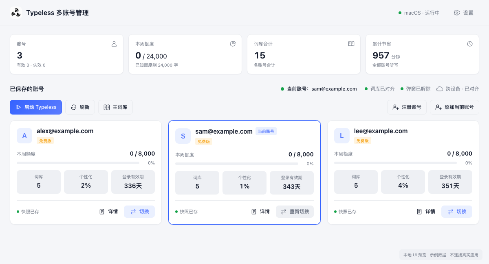

<div align="center">


# Typeless 工具集

專為 Typeless 桌面端打造的本地輔助工具：在單一視窗中管理帳號、詞庫、備份與同步。

[](https://github.com/Jia131313/typeless-toolkit/releases/latest)
[](https://github.com/Jia131313/typeless-toolkit/actions/workflows/check.yml)
[](LICENSE)


[下載最新版本](https://github.com/Jia131313/typeless-toolkit/releases/latest) · [快速開始](#快速開始) · [完整文件](docs/reference.md) · [回報問題](https://github.com/Jia131313/typeless-toolkit/issues)

[English](README.en.md) · [简体中文](README.md) · **繁體中文** · [日本語](README.ja.md) · [한국어](README.ko.md)

</div>

> 這是社群專案，與 [Typeless](https://typeless.com/) 官方無關聯。使用前請閱讀下方的[重要說明](#重要說明)與[免責聲明](#免責聲明)。README 描述目前的 `main` 分支；已發行安裝包的功能以對應 Release 說明為準。

## 專案介紹

Typeless 工具集是執行在自己電腦上的桌面管理器，適合需要在多個 Typeless 帳號之間切換、維護個人詞庫，或移轉帳號資料的使用者。它共用一個本地 Node.js 後端與管理頁面：Windows 使用 WebView2 獨立視窗與系統匣，macOS 使用 Tauri 2 與系統 WKWebView。Linux 尚未支援。

| 能力 | 可以做什麼 |
| --- | --- |
| 多帳號管理 | 收錄目前登入的帳號、檢視狀態、儲存本機登入快照並切換帳號；額度監控可選擇提醒或自動切換。 |
| 詞庫管理 | 彙整各帳號的個人詞條到主詞庫，編輯後視需要對齊；說話風格模型不在可移轉範圍內。 |
| 備份與同步 | 用 WebDAV 加密同步帳號憑證與主詞庫；也可手動匯入、匯出帳號檔案與詞庫。 |
| 桌面維護 | 檢視工具集更新、處理相容性維護；macOS 可安裝 Typeless 已下載並經驗證的官方更新快取。 |

工具集還有裝置識別碼重設、略過新手引導，以及修改 Typeless 應用程式檔案的實驗性彈出視窗維護能力。這些操作與日常帳號、詞庫管理不同，使用前請瞭解[行為與風險](#重要說明)及[平台細節](docs/platform.md#macos-适配)。



_目前管理頁面的範例截圖；帳號、額度與詞庫數字均為虛構資料，不會連線真實應用程式。_

## 下載與安裝

在 [Releases](https://github.com/Jia131313/typeless-toolkit/releases/latest) 選擇與系統和 CPU 架構相符的附件：

| 系統 | 建議下載（檔名後綴） | Lite 版本適合誰 | 啟動方式 |
| --- | --- | --- | --- |
| Windows 10/11 x64 | `win-x64-portable-setup.exe`，內建 Node.js | 已安裝 Node.js 22.12+，建議使用 Node 24 LTS | 執行安裝精靈；免安裝可選 ZIP |
| macOS Apple Silicon | `mac-arm64-portable.dmg`，內建同架構 Node.js | 已安裝同架構 Node.js 22.12+ | 開啟 DMG，將應用程式拖入「應用程式」 |
| macOS Intel | `mac-x64-portable.dmg`，內建同架構 Node.js | 已安裝同架構 Node.js 22.12+ | 開啟 DMG，將應用程式拖入「應用程式」 |

附件名稱會隨版本變動；依表中的後綴選擇即可。剛合併進 `main` 的功能可能尚未納入最新安裝包，請以該 Release 的更新說明為準。

執行前需安裝 Typeless 桌面端。Windows 還需要 Microsoft Edge WebView2 Runtime（多數 Windows 10/11 裝置已具備）。macOS 發行包目前使用 ad-hoc 簽章；首次開啟被系統攔截時，可在 Finder 中對應用程式按右鍵選擇「打開」。每個安裝附件都附有獨立的 SHA-256 驗證檔案。

公開包從空白帳號清單與空白快照目錄開始，不包含維護者的私人資料。Windows 安裝版的資料存放在 `%LOCALAPPDATA%\TypelessToolkit\data`，與程式目錄分離，升級與解除安裝都會保留資料。ZIP 使用者升級時務必保留原解壓縮目錄的 `data/`，不要用新套件中的空白資料目錄覆寫它。

建議優先選用 Portable；Lite 不含 Node.js，體積較小，但需要自行維護執行環境。macOS 使用者資料存放在 `~/Library/Application Support/Typeless 工具集/data/`，替換 App 不會自動搬移或刪除該目錄。

Windows 提供內建 Node 與 Lite 兩種 Setup，也保留兩種 ZIP。日常使用建議採用內建 Node 安裝版，執行環境會隨工具集更新；獨立資料目錄、舊 ZIP 移轉與 Lite 環境維護方式見[Windows 安裝版說明](docs/windows-installer.md)。下載以 Release 實際附件為準。Lite 的基本要求為 Node 22.12+，建議使用 Node 24 LTS；從官網安裝的 Node 不會自行更新，自動切換帳號還需要實際的 SQLite 與 Typeless 資料庫讀取能力。

## 快速開始

1. 啟動 Typeless 並登入一個帳號，再開啟工具集。
2. 在首頁點擊「新增目前帳號」。工具集會暫時取得憑證並儲存本機登入快照；完成後即可從帳號卡片切換。
3. 有多個帳號時，重複上一個步驟。需要持續跨裝置同步，可到「設定 → 同步與資料」設定 WebDAV；若只需單次移轉，則使用「備份與移轉」，在單一檔案中匯出所選帳號與主詞庫。

Typeless 不在預設安裝位置時，可在 `config.json`（原始碼）或 `data/config.json`（Windows 發行包）設定 `typeless_exe`。更多操作、資料目錄及常見問題見[完整文件](docs/reference.md)。

## 重要說明

- **帳號憑證：** 匯出的帳號 JSON 與本機 `accounts.json` 包含長期登入憑證，請像密碼一樣保管，不要上傳到公開 Issue。WebDAV 同步會加密所選的帳號憑證與詞庫，但同步密碼遺失後將無法解密遠端資料。
- **備份範圍：** 移轉備份可包含所選帳號與主詞庫，也可只匯出其中一類；不包含裝置資訊、WebDAV 密碼、本機登入快照或同步刪除記錄。換機匯入後，仍需在目標裝置逐一點擊「在此裝置啟用」。原有的帳號檔案與詞庫 TXT/CSV 仍可匯入。參見[備份與移轉](docs/account-backup.md)及[檔案格式](docs/account-bundle-format.md)。
- **兩種更新：** 「工具集更新」會下載本專案的 Release；macOS 的「安裝 Typeless 官方更新」只處理 Typeless updater 已下載到本機的快取包，不會連線尋找官方最新版。兩者不是同一項操作。
- **應用程式修改：** 彈出視窗維護會修改 Typeless 安裝檔案，可能因官方版本變動而失效，並可能影響 Typeless 原生更新或 macOS 權限。它與裝置重設都應在瞭解影響後使用；失敗還原與排錯方式見[完整文件](docs/reference.md)。

## 免責聲明

本專案為社群專案，與 Typeless 官方無任何關聯、贊助或認可關係；Typeless 軟體及相關商標、著作權的全部權利歸其原始權利人所有。

- **用途限定。** 本工具集供個人學習、研究，以及與你已有權使用的軟體互通之用。它不以規避你本應付費的服務為目的，不得用於商業用途，也不得作為產品轉售或再散布。
- **第三方條款。** 部分功能會修改 Typeless 應用程式檔案或重設裝置識別碼。這些操作可能與 Typeless 的服務條款衝突，並可能在官方更新後失效。使用前請自行確認相關條款與你所在地的法律。
- **無擔保。** 本軟體按「現狀」提供，不附帶任何形式的擔保。作者不對使用本工具集產生的任何後果承擔責任，包括但不限於帳號封鎖、資料遺失或應用程式損壞。
- **責任自負。** 你需自行承擔使用本工具集的方式及其結果。若你所在地法律或 Typeless 服務條款禁止此類操作，請勿使用；繼續使用即視為你已閱讀並接受本聲明。

完整的[使用聲明與授權條款](docs/reference.md#使用声明与许可证)見詳細文件。

## 從原始碼執行

需要 Node.js 22.12+；開發與建置說明以儲存庫檔案為準。

```bash
npm ci
npm run check
node manager.js
```

管理頁面預設位於 `http://127.0.0.1:7788`。macOS 可執行 `npm run build:mac` 建置目前架構的 Portable DMG；Windows 打包入口與注意事項見[安裝指南](docs/installation.md#windows-桌面窗口与托盘)。主要程式碼分工為：`manager.js` 提供本地 API，`manager.html` 是管理頁面，`lib/` 放共用業務邏輯，`windows/` 與 `src-tauri/` 分別是 Windows、macOS 桌面宿主。

## 文件與回饋

- [文件導覽：安裝、帳號與備份、同步、排錯和平台實作](docs/reference.md)
- [Typeless Account Bundle v1：帳號檔案格式](docs/account-bundle-format.md)
- [提交 Issue](https://github.com/Jia131313/typeless-toolkit/issues)：請附上作業系統、Typeless 與工具集版本、重現步驟及錯誤訊息；請勿附上帳號憑證、詞庫私有資料或 WebDAV 密碼。

本專案採用 [MIT 授權條款](LICENSE)。感謝 [LINUX DO 論壇社群](https://linux.do/) 的關注、回饋與支援；裝置重設思路參考了 [typeless-reset-device](https://github.com/estarpro1022/typeless-reset-device)。

## 介面語言

內建九種介面語言：简体中文、繁體中文、English、日本語、한국어、Español、Français、Deutsch、Türkçe。可在「設定 → 一般 → 介面語言」中切換。翻譯隨套件內建，不需要連網；語言偏好會在重新啟動後保留。用法、維護與驗證方式見 [LOCALIZATION.md](docs/LOCALIZATION.md)。
